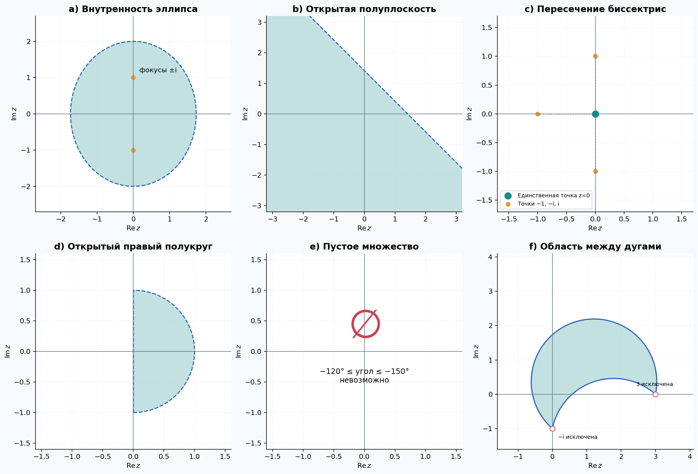

# Листок 2: комплексные числа

Готовый учебный ноутбук: [worksheet_02_complex_numbers.ipynb](worksheet_02_complex_numbers.ipynb).
В начале — подробная теория с рисунками, дальше — решения всех задач, включая задания со звёздочкой. Все графики и результаты уже встроены в файл. Краткие объяснения ниже можно читать без знания Python.

## Как открыть

Откройте `.ipynb` в JupyterLab, Jupyter Notebook или VS Code с расширением Jupyter. Сохранённые результаты можно смотреть без выполнения. Для пересчёта нужен Python 3.10 или новее:

```bash
python3 -m venv .venv
source .venv/bin/activate
python -m pip install -r requirements.txt
python -m jupyter lab worksheet_02_complex_numbers.ipynb
```

В Windows вместо `source ...` используйте `.venv\Scripts\activate`. Выберите ядро созданного окружения и команду **Restart Kernel and Run All Cells**. Выполняйте ячейки сверху вниз: первые задают функции для последующих. Исходный PDF и интернет для вычислений не нужны; интернет нужен только при установке библиотек. Дополнительные изображения сохраняются в `figures/`.

## Самая короткая теория

Комплексное число `x + yi` — точка с координатами `(x, y)`. Число `i` устроено так, что `i² = −1`. Модуль — расстояние от нуля, аргумент — угол направления. При умножении расстояния перемножаются, а углы складываются. При извлечении корня делим угол, учитывая все полные обороты: поэтому у ненулевого числа есть несколько комплексных корней.

В Python мнимая единица — `1j`, степень — `**`, модуль — `abs(z)`. Например, `(1 + 1j)**2` равно `2j`.

## Что происходит в каждом решении

### 2.1. Три способа записать число

Сначала раскрываем скобки и избавляемся от комплексного знаменателя: умножаем дробь сверху и снизу на сопряжённое число. Получаем **10 − 11i**, **2**, **−64**. Затем находим расстояние от нуля и угол: это даёт тригонометрическую и показательную формы. Для больших степеней проще сразу работать с расстоянием и углом.

### 2.2. Восемь корней из 1 + i

Число `1 + i` имеет модуль √2 и угол 45°. Из модуля берём восьмой корень, угол делим на 8. Остальные решения получаются поворотами на 45°. Ответ — восемь вершин правильного восьмиугольника: **zₖ = 2^(1/16) · exp(i(π/32 + πk/4))**, k от 0 до 7.

### 2.3. Несколько наборов корней

Сначала упрощаем выражение под корнем, затем повторяем способ из 2.2. Подкоренные числа: **1**, **−9/2 + (9√3/2)i**, **9 − 8i**, **1 − i**. Получаем соответственно **8, 4, 3 и 9 корней**. В каждом наборе точки находятся на одной окружности с одинаковым угловым шагом. Ноутбук выводит формулы, координаты и проверяет степени всех корней.

### 2.4. Области на плоскости

- **a:** сумма расстояний до двух точек меньше четырёх — это внутренность эллипса: **x²/3 + y²/4 < 1**.
- **b:** действительная часть произведения равна `x + y`. Получаем полуплоскость **x + y < √2**.
- **c:** точка должна находиться на одинаковом расстоянии от −1, −i и i. Уравнения расстояний дают единственный ответ: **z = 0**.
- **d:** дробь должна лежать в первой четверти. Положительность её действительной и мнимой частей даёт **x > 0, x² + y² < 1** — открытую правую половину круга.
- **e:** написано, что угол одновременно не меньше −120° и не больше −150°. Это невозможно, поэтому **множество пустое**. Условие не исправлялось молча.
- **f:** дробь должна попасть в сектор вокруг направления вниз. После раскрытия дроби получаем **V < 0, √3|U| ≤ −V**, где `U = 3x − x² − y² − y`, `V = x − 3y − 3`; точку **z = −i исключаем**. Это область между двумя дугами. Дуги входят, их концы **3** и **−i** — нет: в первом конце нет аргумента, во втором нет самой дроби.



### 2.5*. Как узнать окружность по уравнению

Собираем выражение в полный квадрат — как в школьной алгебре. Получается квадрат расстояния до одной точки. Поэтому центр равен **−B/A**, радиус — **√(|B|² − AC)/A**. В условии гарантировано, что выражение под корнем положительно. Важно не перепутать `B` и сопряжённое к нему число.

### 2.6. Корни многочлена степени 11

Все корни ищем численно, затем проверяем подстановкой, формулами Виета и вторым способом вычисления. Полный список есть в ноутбуке. Складывая расстояния всех корней от нуля, получаем **11.973384469712**. Самая большая действительная часть равна **1.080601737358**; она одинакова у двух сопряжённых корней. Сумма расстояний — не то же самое, что расстояние до суммы.

### 2.7. Сочетания для комплексных чисел

Обычный факториал заменяем гамма-функцией. Подставляем два комплексных числа в заданную формулу: результат **4.367449140640 + 4.851629765158i**. Угол этого числа — около **0.837869 радиана**, или **48.0064°**. В последнем пункте верхний индекс равен **1/z**. Для каждой точки считаем угол результата и рисуем линии одинакового угла. Особые точки маскируем, а возле нуля учитываем ограничение разрешения сетки.

### 2.8. Определитель с комплексным параметром

Корни 14-й степени из единицы равномерно стоят на окружности. Самый правый корень выше горизонтальной оси имеет угол **π/7**. Подставляем его в обычную формулу определителя матрицы 2×2. Получаем **−7.267790387019 + 4.686785134526i**.

### 2.9*. Множества Жюлиа

Много раз применяем функцию к стартовому числу. Для `z² + c` раскрашиваем точки по времени ухода: видим приближение заполненного множества Жюлиа и его границы для обоих заданных `c`. Отсутствие ухода за конечное число шагов ещё не доказывает, что точка никогда не уйдёт.

Для двух дробных функций используем обратный ход: ищем прообразы и случайно выбираем один из них. После многих шагов точки приближают множество Жюлиа. Обычный порог большого модуля здесь не подходит: следующая итерация может вернуться назад. В ноутбуке есть все четыре изображения и пояснение точности методов.

### 2.10-I*. Кривые на сфере Римана

Сфера Римана — способ представить комплексную плоскость вместе с одной точкой бесконечности. Формулы переводят каждую плоскую точку в точку сферы. Подставляем параметризации прямой, окружности, параболы и обеих ветвей гиперболы. Прямая приближается к северному полюсу, а единичная окружность становится экватором. Конкретные уравнения в листке не заданы, поэтому простые примеры выбраны и явно указаны в ноутбуке.

### 2.10-II*. Логарифмическая спираль

Радиус спирали растёт по закону **r = a·exp(bφ)**, а точка вращается на угол φ. Переводим её на сферу теми же формулами. При `a > 0`, `b > 0` один конец приближается к южному полюсу, другой — к северному. В примере **a = 0.7**, **b = 0.18**. В исходном PDF это второе отдельное задание с номером 2.10; оба задания выполнены.

## Проверка и точность

Все ячейки выполнены последовательно; результаты и рисунки сохранены. Код содержит проверки арифметики, корней, областей, определителя, обратных отображений и принадлежности точек сфере. Приближённые ответы округлены. Фракталы и линии уровня имеют конечное разрешение; это иллюстрации, а не доказательства тонких свойств множеств.

Источник заданий: предоставленный листок П. Е. Рябова «Комплексные числа. Геометрия комплексных чисел». Дополнительные математические источники и ссылки приведены в конце ноутбука.
